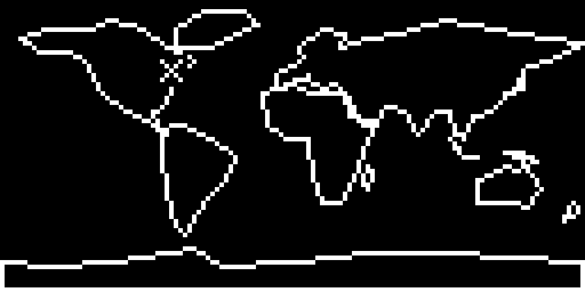
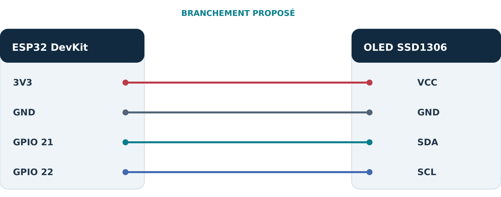

# 🛰️ ISS Live Tracker — ESP32

**Suivi de la Station spatiale internationale sur un écran OLED 128 × 64, à partir de sa position en temps réel.**

**ESP32** · **MicroPython** · **Wi-Fi** · **SSD1306 OLED** · **I²C** · **API REST / JSON**

Projet pédagogique réalisé en équipe par **Meryem Belouaar et Khalid Asseffar**, pour le cours **Programmation d'objets connectés — Institut Grasset**.

## Démonstration du résultat



*Représentation illustrative de l'affichage de la position de l'ISS. Cette image n'est pas une capture de télémétrie en direct.*

L'ESP32 se connecte au Wi-Fi, lit les coordonnées de l'ISS via l'API **Open Notify**, valide la réponse JSON et convertit la latitude et la longitude en coordonnées d'écran. Le programme trace une carte du monde simplifiée et affiche la position de l'ISS avec un marqueur **X**. L'affichage se rafraîchit périodiquement et les erreurs de réseau sont gérées.

## 📟 Montage

| ESP32 | OLED SSD1306 | Fonction |
|---|---|---|
| 3V3 | VCC | Alimentation 3,3 V |
| GND | GND | Masse commune |
| GPIO21 | SDA | Données I²C |
| GPIO22 | SCL | Horloge I²C |



**Débrancher le câble USB avant toute modification du câblage.** Affichage : 128 × 64 pixels, adresse I²C attendue **0x3C**.

## 🚀 Installation sur la carte

1. Installer **MicroPython pour ESP32** et ouvrir [Thonny](https://thonny.org/).
2. Réaliser le branchement indiqué ci-dessus.
3. Copier `code/config_example.py` en `config.py`, puis renseigner localement le SSID et le mot de passe Wi-Fi.
4. Envoyer les fichiers Python du dossier `code/` à la racine de la carte, ainsi que votre fichier privé `config.py`.
5. Exécuter `main.py` depuis la carte. Pour tester l'écran seul, utiliser `test_oled.py`.

Le fichier privé **`config.py` est ignoré par Git** et ne doit jamais être publié. Le réseau Wi-Fi doit disposer d'un accès Internet pour joindre l'API de position.

## 🧭 Projection des coordonnées

Les coordonnées géographiques sont converties en pixels de l'écran (projection équirectangulaire simplifiée) :

```python
x = int((longitude + 180) * 128 / 360)
y = int((90 - latitude) * 64 / 180)
```

Les indices sont limités à `x = 0…127` et `y = 0…63`. La carte et le marqueur X sont dessinés avec les primitives graphiques SSD1306.

## 📁 Structure du dépôt

| Chemin | Rôle |
|---|---|
| `code/main.py` | Boucle principale et gestion de l'affichage |
| `code/iss_api.py` | Connexion Wi-Fi, lecture de l'API et validation JSON |
| `code/display.py` | Dessin, projection et marqueur X |
| `code/world_map.py` | Contours schématiques des continents |
| `code/settings.py` | Paramètres techniques |
| `code/ssd1306.py` et `code/urequests.py` | Pilote OLED et client HTTP |
| `verification/` | Tests logiciels hors carte |
| `illustrations/` | Schéma de branchement, organigramme et aperçu |
| `Rapport_TP_ISS_Khalid_Meryem.pdf` | Rapport technique |
| `Presentation_TP_ISS_Khalid_Meryem_AMELIOREE.pptx` | Présentation |

## ✅ Tests

Après deux corrections ciblées, **10 tests logiciels sur 10 passent** sur ordinateur. Ces contrôles vérifient la syntaxe Python, la projection, la validation des coordonnées et réponses API, le dessin du marqueur, ainsi que des cas de panne simulés.

```bash
python -m pip install Pillow
python verification/tests_hors_carte.py
```

**Limites :** ces tests utilisent des interfaces simulées. Ils ne remplacent pas la validation du réseau, de l'API en direct ou de l'OLED sur une carte physique.

Voir [les tests](verification/tests_hors_carte.py), [les résultats](verification/resultats_hors_carte.json) et [l'historique des changements](CHANGELOG.md).

## 📚 Documentation

- [Rapport technique (PDF)](Rapport_TP_ISS_Khalid_Meryem.pdf)
- [Présentation (PPTX)](Presentation_TP_ISS_Khalid_Meryem_AMELIOREE.pptx)
- [Organigramme](illustrations/Organigramme_Programme.png)
- [Schéma de branchement](illustrations/Schema_Branchement_ESP32_OLED.png)
- [Sources et licences tierces](SOURCES_ET_LICENCES.md)

## 👥 Contributions et attribution

- **Meryem Belouaar** : affichage OLED, projection des coordonnées, continents et marqueur de l'ISS.
- **Khalid Asseffar** : configuration ESP32, câblage, Wi-Fi, API et boucle principale.
- **Travail d'équipe** : intégration, tests, rapport et présentation.

Les dépendances MicroPython et leurs notices de licences sont préservées dans le dépôt. Ce projet est une **réalisation scolaire collaborative**, conservant la provenance et l'historique du dépôt d'origine.

---
*Données ISS : [Open Notify](http://open-notify.org/Open-Notify-API/ISS-Location-Now/).*
